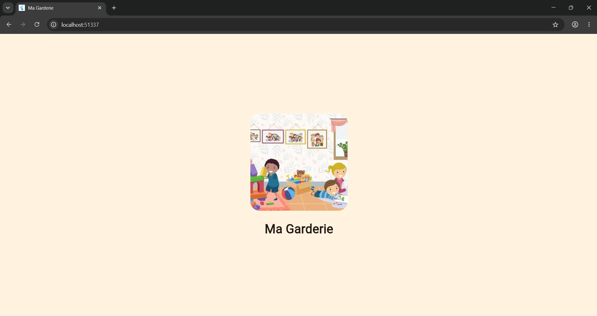
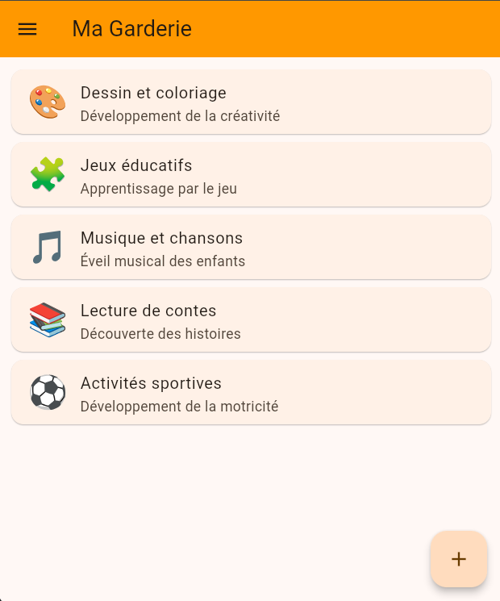
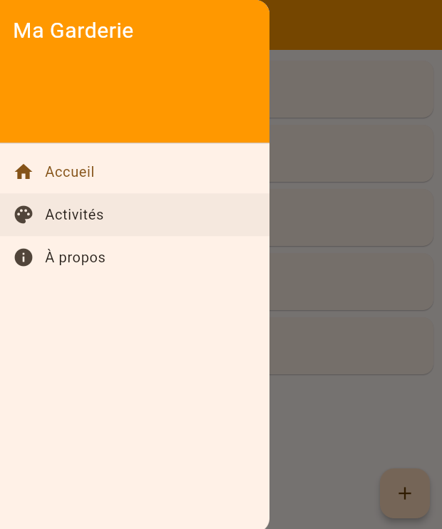
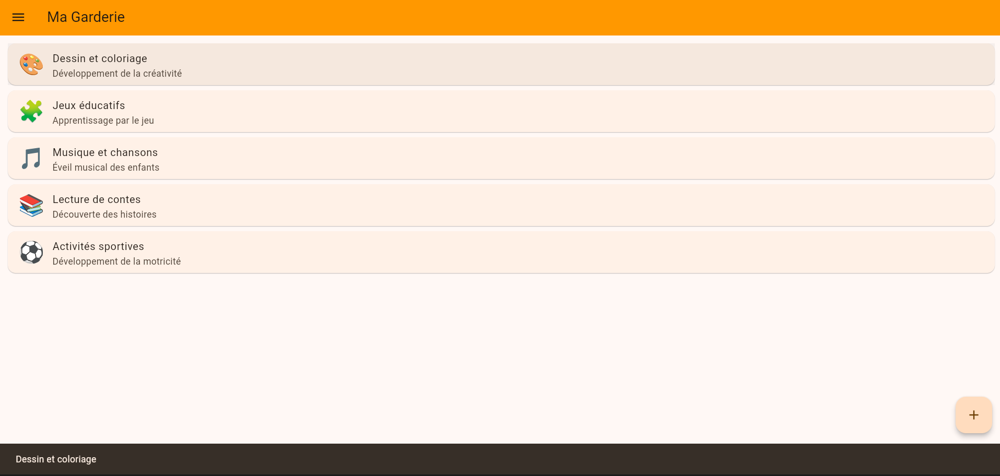

# Ma Garderie 🧒

Application mobile de présentation d'une garderie d'enfants : écran de démarrage,
liste des activités, menu latéral et interactions. Données statiques, sans backend.

## Technologies utilisées
- Flutter / Dart
- Git & GitHub (workflow par branches : feature/*, docs/*)

## Installation et exécution
```bash
git clone https://github.com/yassinefekih123/garderie-mobilee.git
cd garderie-mobilee
flutter pub get
flutter run
```
Prérequis : Flutter SDK installé, un émulateur Android ou un appareil connecté.

## Captures d'écran
| Splash Screen | Page principale |
|---|---|
|  |  |

| Drawer ouvert | Message après interaction |
|---|---|
|  |  |

## Auteur
Yassine Fekih